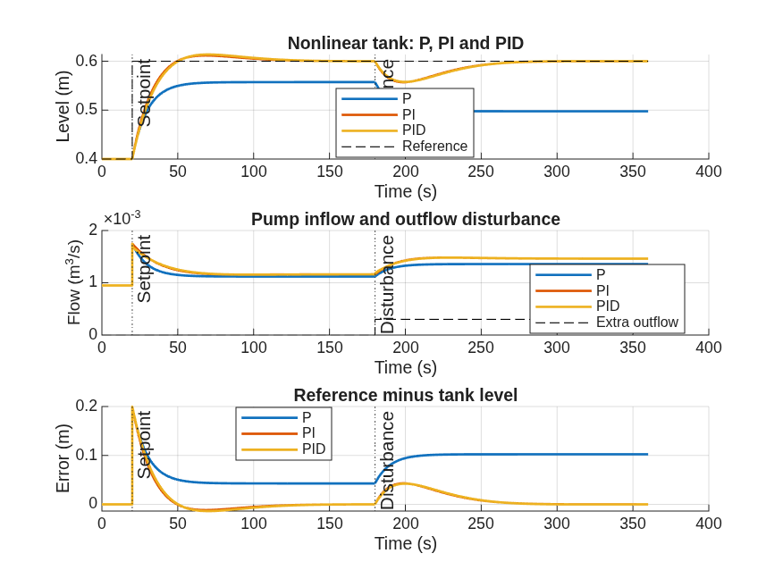

# Nonlinear Tank-Level Control in MATLAB & Simulink

A simulation study of feedback control for a single liquid tank, comparing **P, PI and PID** controllers under a setpoint change and an additional outflow disturbance. Prepared as an Instrumentation & Control portfolio project for a bp summer internship application.

The objective is to regulate tank level while examining tracking accuracy, transient response, actuator constraints and disturbance rejection. The supplied simulations were executed in MATLAB Online. This repository contains the model, its programmatic builder, the experiment runner and the saved numerical evidence.



## Mathematical model

For a constant-area tank with a gravity-driven outlet, conservation of volume gives

$$A\frac{dh}{dt}=q_{in}-k_{out}\sqrt{h}-d(t).$$

Here, $h$ is liquid level (m), $A$ is tank cross-sectional area (m²), $q_{in}$ is pump inflow (m³/s), $k_{out}\sqrt{h}$ is natural outlet flow (m³/s), and positive $d(t)$ is an additional withdrawal (m³/s). The square-root outlet relation makes the plant nonlinear.

| Parameter | Saved value |
| --- | --- |
| Tank area, $A$ | 0.05 m² |
| Outlet coefficient, $k_{out}$ | 0.0015 m^(5/2)/s |
| Initial level and reference | 0.4 m |
| Reference step | 0.4 → 0.6 m at 20 s |
| Additional withdrawal | 0 → 0.0003 m³/s at 180 s |
| Pump inflow limits | 0–0.004 m³/s |
| Initial equilibrium inflow, $q_{bias}$ | 0.0009486833 m³/s |
| Simulation duration | 360 s |

The level integrator has a lower limit of zero. The idealized tank has no upper wall or overflow model. Constant area, a fixed outlet coefficient, direct level measurement and an instantaneous saturated pump are assumed; sensor noise, transport delay and actuator dynamics are not included.

## Feedback architecture

The reference is compared with measured level to form $e=r-h$. The unsaturated command combines equilibrium bias, proportional action, an integral state and a filtered derivative of measured level:

$$u=q_{bias}+K_p e+x_I-v_D,\qquad q_{in}=\operatorname{sat}_{[0,q_{max}]}(u),$$

$$\dot{x}_I=\gamma\left[K_i e+K_{aw}(q_{in}-u)\right],\qquad
v_D(s)=\frac{K_dNs}{s+N}\,[h(s)-h_0(s)].$$

In the derivative expression, the input is the time-domain level deviation $h(t)-h_0$, with $h_0$ a constant. Applying derivative action to this measurement deviation avoids a setpoint derivative kick and an initial level-offset kick. Back-calculation feeds the difference between saturated and unsaturated commands into the integral path. Integral action is disabled for P ($\gamma=0$) and enabled for PI/PID ($\gamma=1$).

| Experiment | $K_p$ (m²/s) | $K_i$ (m²/s²) | $K_d$ (m²) |
| --- | ---: | ---: | ---: |
| P | 0.004 | 0 | 0 |
| PI | 0.004 | 0.00015 | 0 |
| PID | 0.004 | 0.00015 | 0.004 |

The derivative filter coefficient is $N=5$ s⁻¹ and the anti-windup gain is $K_{aw}=0.2$ s⁻¹. These are fixed illustrative gains, not optimized tuning. Each experiment uses the same plant, reference, disturbance and proportional gain.

## Verified performance

Values below are rounded from [metrics.csv](results/metrics.csv). All ten metrics per controller were independently recomputed from the saved time series in [experiment_data.mat](results/experiment_data.mat), matching the CSV to numerical tolerance. Each case contains 3,606 samples over 0–360 s. The saved plot was visually inspected; the model archive, workspace parameters, block connections and solver configuration were also inspected. This preparation did not rerun MATLAB or Simulink, which are unavailable in the preparation environment.

| Controller | IAE (m·s) | ISE (m²·s) | Tracking overshoot (%) | 10–90% rise (s) | Tracking settling (s) | Peak post-disturbance error (m) | Disturbance recovery (s) | Final mean error (m) |
| --- | ---: | ---: | ---: | ---: | ---: | ---: | ---: | ---: |
| P | 26.236 | 2.3310 | 0.00 | — | — | 0.10237 | — | 0.10237 |
| PI | 4.518 | 0.2891 | 5.87 | 20.22 | 86.98 | 0.04287 | 83.10 | −0.00003737 |
| PID | 4.733 | 0.3048 | 6.85 | 21.02 | 92.46 | 0.04229 | 83.30 | −0.00007949 |

Metric conventions follow `run_experiments.m`:

- IAE and ISE integrate absolute and squared tracking error over the entire run using the trapezoidal rule.
- Tracking metrics use 20 ≤ t < 180 s. Rise time uses interpolated crossings of 0.42 and 0.58 m; overshoot is normalized by the 0.2 m reference step.
- Settling and recovery use a ±0.004 m band: 2% of the **step amplitude**, not 2% of the final level. They measure elapsed time from 20 s and 180 s respectively, using the first logged sample after the final band violation within the relevant window.
- “—” represents CSV `NaN`: the criterion was not reached in the observed window. P never reaches the 90% rise threshold or the settling band.
- Peak post-disturbance error is the maximum absolute deviation from 0.6 m for t ≥ 180 s; it includes any existing tracking offset.
- Final mean error is the arithmetic mean of reference minus level over 342–360 s. Pre-disturbance means use 164 ≤ t < 180 s: P = 0.0427609 m, PI = −0.00005515 m, PID = −0.000007315 m.
- Time-weighted pump saturation is **0% for all three cases**. The saved experiments therefore do not demonstrate anti-windup performance under saturation.

For these gains, P leaves a persistent tracking offset that grows under extra withdrawal. PI and PID restore the level to the specified band after the disturbance. PI has the lowest full-run IAE and ISE, faster tracking settling and lower tracking overshoot than PID. PID slightly reduces peak post-disturbance error, but does not improve recovery time. These comparisons apply to this scenario and tuning only.

## Run the project

**Requirements:** MATLAB and Simulink. The saved model identifies MATLAB **R2026b**; compatibility with older releases has not been tested. The scripts use MATLAB and Simulink functionality without additional tuning or optimization toolboxes.

Open this folder in MATLAB Online or desktop MATLAB and run:

```matlab
run_experiments
```

The runner loads `tank_control.slx`, executes P/PI/PID cases using `Simulink.SimulationInput`, and overwrites the four result files. If the model file is absent, it invokes the builder automatically. To inspect the supplied model:

```matlab
open_system('tank_control.slx')
```

To deliberately regenerate the model from the builder:

```matlab
build_model       % Replaces tank_control.slx
run_experiments
```

Parameters are stored in model workspace variable `p` (Model Explorer → tank_control → Model Workspace). The runner reads that workspace and overrides gains for each case; editing only the builder does not update an existing model until it is rebuilt. The configured solver is variable-step `ode45`, maximum step 0.1 s, relative tolerance 1e-6 and absolute tolerance 1e-8.

## Repository contents

```text
.
├── README.md
├── .gitignore
├── build_model.m                 # Programmatic model construction
├── run_experiments.m             # Three experiments, metrics and plots
├── tank_control.slx              # Supplied Simulink model
└── results/
    ├── comparison.png           # GitHub-viewable saved figure
    ├── comparison.fig           # Editable MATLAB figure
    ├── experiment_data.mat      # Time series, parameters, summary and gains
    └── metrics.csv              # Full-precision performance metrics
```

Within `experiment_data.mat`, `results.P`, `results.PI` and `results.PID` contain `time`, `signals` and `parameters`. Signal columns are reference level, tank level, pump inflow, extra withdrawal and natural outlet flow. The file also saves `summary` and `gains`.

Generated `slprj/` and `.slxc` simulation caches are excluded. The supplied scripts, model and four result files are preserved unchanged. All files referenced by the scripts are present. No hardware measurements or industrial deployment validation are supplied; this is a simulation portfolio study demonstrating process modelling, feedback implementation and quantitative comparison.
